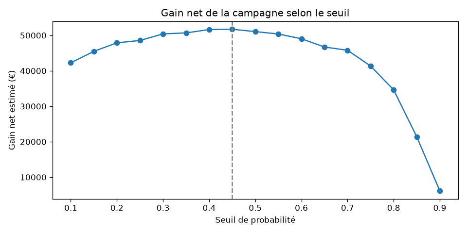

# Prédiction du churn client — opérateur télécom

## En bref

- **Question** : quels clients risquent de résilier, et combien faut-il en contacter pour qu'une campagne de rétention soit rentable ?
- **Données** : 7 043 clients d'un opérateur télécom fictif (IBM), 26,5 % de churn.
- **Modèle retenu** : régression logistique, à égalité statistique avec XGBoost et Random Forest, mais explicable.
- **Résultat** : en contactant 631 clients (seuil de 0,45), la campagne rapporterait environ 51 700 € nets sur le jeu de test, sous des hypothèses de coût détaillées plus bas.
- **Ce que je retiens** : le seuil de décision est une question métier. Si le coût de l'offre double, le seuil optimal passe de 0,45 à 0,70.

---

## 1. Contexte

Je travaille principalement en BI (Power BI, SQL Server). Ce projet me sert à remettre en pratique la modélisation prédictive en Python, sur un cas où le résultat doit déboucher sur une décision concrète : qui contacter, et à quel coût.

Pour un opérateur à abonnement, garder un client coûte en général moins cher qu'en acquérir un nouveau. L'objectif est donc de repérer les clients à risque **avant** qu'ils partent, pour leur proposer une offre de rétention.

## 2. Données

Dataset [Telco Customer Churn](https://github.com/IBM/telco-customer-churn-on-icp4d) publié par IBM : 7 043 clients, 21 colonnes.

- **Profil** : sexe, senior, conjoint, personnes à charge
- **Services** : téléphone, internet (DSL, fibre, aucun), options (sécurité, sauvegarde, support, streaming…)
- **Contrat** : type d'engagement, mode de paiement, facture dématérialisée
- **Montants** : facture mensuelle (`MonthlyCharges`), total payé (`TotalCharges`)
- **Ancienneté** : `tenure`, en mois
- **Cible** : `Churn`, le client est-il parti (Yes/No)

## 3. Nettoyage

- **`TotalCharges` était lu comme du texte.** 11 lignes contenaient un espace au lieu d'un montant. Toutes concernaient des clients à 0 mois d'ancienneté, pas encore facturés : j'ai remplacé ces valeurs par 0 plutôt que par la moyenne, qui n'aurait eu aucun sens pour un nouveau client.
- **`customerID` est exclu** : c'est un identifiant, sans valeur prédictive.
- **La cible est convertie en 0/1.**

Le nettoyage est regroupé dans `src/data.py`, pour être réutilisé à l'identique dans chaque notebook.

## 4. Exploration

### Taux de churn
26,5 % des clients sont partis. La cible est déséquilibrée : un modèle qui répondrait toujours « le client reste » aurait déjà 73,5 % de bonnes réponses. L'accuracy n'est donc pas une bonne métrique ici.

### Le contrat, facteur le plus net

| Contrat | Taux de churn |
|---|---|
| Au mois | 43 % |
| 1 an | 11 % |
| 2 ans | 3 % |

Attention à l'interprétation : un contrat long réduit le churn de façon mécanique (on ne peut pas partir sans pénalité), mais ce sont aussi les clients déjà fidèles qui choisissent de s'engager. C'est une corrélation, pas forcément une cause.

### La fibre optique
Les clients fibre churnent nettement plus que les clients DSL. Ils paient aussi beaucoup plus cher : 91,50 par mois en moyenne, contre 58,10 en DSL et 21,08 sans internet. Le prix est une piste cohérente, mais le dataset ne permet pas de tester les autres explications possibles (concurrence, qualité de service).

### L'ancienneté
Les premiers mois sont les plus risqués : environ 60 % de départs chez les clients de 0 à 2 mois, moins de 10 % après cinq ans.

| | Churners | Non-churners |
|---|---|---|
| Ancienneté médiane | 10 mois | 38 mois |
| Montant mensuel médian | 79,65 | 64,43 |
| Total payé médian | 704 | 1 680 |

Les churners paient **plus** cher par mois, mais ont un total payé **plus faible**, simplement parce qu'ils sont partis tôt.

### Corrélations
`TotalCharges` est très corrélée à `tenure` (0,83), puisque le total payé est à peu près l'ancienneté multipliée par le montant mensuel. Ce point a compté pour la modélisation.

## 5. Modélisation

### Protocole
- Découpage 80 % entraînement / 20 % test, **stratifié** pour garder 26,5 % de churn dans les deux jeux.
- Préparation dans un pipeline scikit-learn : standardisation des variables numériques, encodage one-hot des variables catégorielles (40 colonnes au final). La préparation n'apprend que sur le jeu d'entraînement.
- Métrique principale : **PR-AUC**, adaptée quand la classe qui nous intéresse est minoritaire.

### Premier modèle : l'effet du déséquilibre
Une première régression logistique sans pondération donne 80,6 % d'accuracy, mais ne détecte que **56 %** des churners (165 ratés sur 374). Avec une pondération des classes (`class_weight="balanced"`) :

| | Sans pondération | Avec pondération |
|---|---|---|
| Rappel (churners détectés) | 56 % | 78 % |
| Précision | 66 % | 50 % |
| Churners ratés | 165 | 81 |
| Fausses alertes | 109 | 288 |
| Accuracy | 80,6 % | 73,8 % |

L'accuracy baisse alors que le modèle devient plus utile : c'est la preuve qu'elle trompe sur ce type de problème. Les AUC, elles, ne bougent presque pas (0,84), car la pondération change surtout le seuil, pas le classement des clients.

*(Chiffres calculés sur le jeu de test, avec `TotalCharges` encore incluse.)*

### Comparaison de 4 modèles
Validation croisée en 5 plis sur le jeu d'entraînement, tous les modèles pondérés :

| Modèle | PR-AUC moyenne | Écart-type |
|---|---|---|
| XGBoost | 0,667 | 0,022 |
| Random Forest | 0,663 | 0,021 |
| **Régression logistique** ✅ | 0,660 | 0,020 |
| Arbre de décision | 0,616 | 0,029 |

Les trois premiers sont séparés de moins de 0,01, alors que l'écart-type est d'environ 0,02 : ils sont **à égalité statistique**. J'ai appliqué la règle suivante : prendre le modèle le plus simple dont le score reste à moins d'un écart-type du meilleur (0,667 - 0,022 = 0,645). La régression logistique passe ce seuil, et elle a l'avantage d'être explicable à une équipe métier.

### Retrait de `TotalCharges`
Avec `TotalCharges`, les coefficients de la logistique contredisaient l'exploration (`TotalCharges` augmentait le risque, `MonthlyCharges` le diminuait). C'est un effet de la multicolinéarité : les variables se partagent artificiellement le même effet.

Sans `TotalCharges`, la PR-AUC reste la même (0,658 ± 0,019 contre 0,660), et les coefficients deviennent lisibles. À performance égale, je garde le modèle le plus simple.

## 6. Ce que dit le modèle

<!-- Ajouter la figure une fois enregistrée :  -->

- **Augmentent le risque** : fibre optique, contrat au mois, facture dématérialisée, paiement par chèque électronique, absence de sécurité en ligne ou de support technique.
- **Diminuent le risque** : ancienneté, contrat de deux ans, internet DSL.

Une nuance importante : `MonthlyCharges` reste négatif. Un coefficient se lit « toutes les autres variables étant égales ». Or le prix dépend presque entièrement des services souscrits (fibre, streaming…), déjà présents dans le modèle. À services identiques, payer plus cher n'augmente donc pas le risque : c'est le type d'offre qui compte, plus que le prix lui-même.

## 7. Le seuil, une décision métier

Le modèle donne une probabilité de départ. Reste à décider à partir de quelle probabilité on contacte un client. J'ai simulé le gain net d'une campagne pour chaque seuil.

**Hypothèses de travail** (inventées pour la démonstration, à valider avec le marketing) :
- une offre de rétention coûte **50 €** par client contacté ;
- elle convainc **30 %** des vrais churners de rester ;
- un client retenu rapporte **12 mois** de son abonnement.



Le gain forme un plateau entre 0,30 et 0,55 : le seuil exact importe peu dans cette zone.

| Coût de l'offre | Seuil optimal | Clients contactés | Gain net (jeu de test) |
|---|---|---|---|
| 50 € | 0,45 | 631 | ~51 700 € |
| 100 € | 0,70 | 363 | ~27 650 € |

Avec une offre à 100 €, contacter trop largement devient même déficitaire (environ -13 000 € au seuil de 0,10). Le modèle n'a pas changé, mais la bonne décision, si.

## 8. Limites

- **Dataset fictif et sans dates** : impossible de valider le modèle sur une période future, ce qu'on ferait en conditions réelles.
- **Hypothèses de coût inventées** : ce sont elles qui fixent le seuil. Avec de vrais chiffres, les conclusions changeraient.
- **Seuil choisi sur le jeu de test** : ce n'est pas parfaitement rigoureux. En production, il faudrait le choisir sur des prédictions issues de la validation croisée.
- **Prédire n'est pas expliquer** : le modèle repère qui va partir, pas qui serait sensible à une offre. Pour ça, il faudrait un modèle d'uplift et l'historique de campagnes passées.

## 9. Pistes d'amélioration

- Choisir le seuil par validation croisée plutôt que sur le test.
- Créer des variables métier (nombre de services souscrits, client de moins de 6 mois sans engagement…).
- Calibrer les probabilités avant de les utiliser dans un calcul financier.
- Restituer les scores dans un rapport Power BI pour suivre les clients à risque.

## 10. Structure du projet

```
churn-telco/
├── data/raw/                   # CSV source (IBM)
├── notebooks/
│   ├── 01_exploration.ipynb    # analyse descriptive
│   └── 02_modelisation.ipynb   # modèles, interprétation, seuil
├── reports/figures/            # graphiques
├── src/
│   └── data.py                 # chargement et nettoyage
├── requirements.txt
└── README.md
```

## 11. Lancer le projet

```bash
git clone https://github.com/Bahimer/churn-telco.git
cd churn-telco
python -m venv .venv
.venv\Scripts\activate          # Windows
pip install -r requirements.txt
```

Puis ouvrir les notebooks dans l'ordre.

**Stack** : Python, pandas, scikit-learn, XGBoost, matplotlib, seaborn, Git